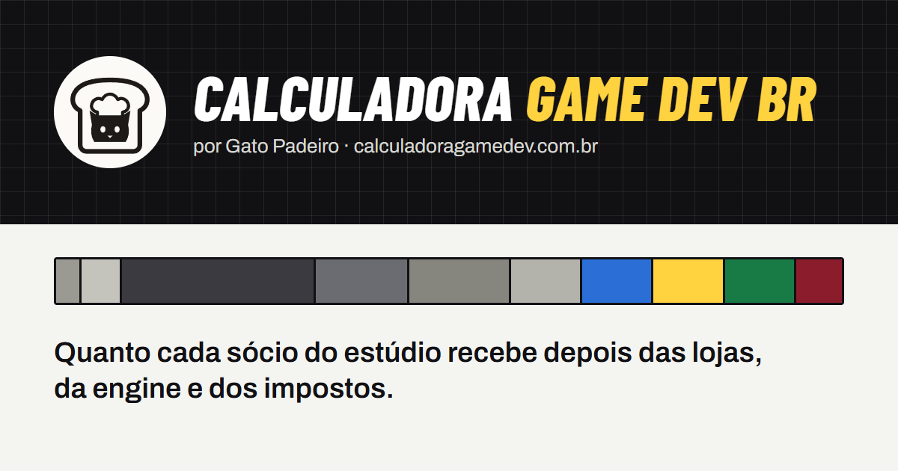

# Calculadora Game Dev BR

Quanto sobra de uma venda de jogo depois que a loja, a engine e os impostos passam a mão? A gente da [Gato Padeiro](https://www.gatopadeiro.com.br) se fez essa pergunta antes de lançar o primeiro jogo, montamos uma planilha, depois um simulador, ~bateu a depressão ao ver a quantidade de impostos~, e pensei, e se fosse algo publico? gastei um final de semana e acabou virando esta calculadora.

Ta disponivel em:  **[calculadoragamedev.com.br](https://calculadoragamedev.com.br)**.



## O que ela calcula

- Vendas por país e por loja (Steam, Epic, consoles, App Store e Google Play), cada uma na sua moeda, com câmbio do dia.
- Imposto embutido no preço, reembolsos, taxa de cada loja e a retenção de 30% dos EUA.
- Royalty da Unreal, IRRF e IOF da remessa.
- Simples Nacional (Anexo III ou V pelo Fator R) ou Lucro Presumido.
- Pró-labore, salários, 13º, férias e FGTS.
- Divisão do lucro entre sócios, inclusive em camadas (um sócio pode ser um grupo que se divide de novo).
- O que cada sócio leva: INSS, IRPF, retenção de dividendos e imposto mínimo de 2026.

Tudo roda no navegador. Não tem conta, não tem servidor; o cenário fica salvo no próprio navegador e num link que dá para mandar para o contador.

**É uma simulação, não consultoria.** As regras mudam e cada estúdio tem detalhes que a calculadora não enxerga. Confirme os números com quem cuida da sua contabilidade.

## Rodando na sua máquina

Precisa do Node 20.19 ou mais novo.

```bash
npm install
npm run dev
```

Os testes:

```bash
npm test
```

## Onde fica cada coisa

```
src/
  dados/        tabelas das lojas, engines, países e tributos, cada uma com fonte e vigência
  calculo/      as contas, sem nada de interface, com testes
  cambio/       busca das cotações (AwesomeAPI, com a Frankfurter de reserva)
  estado/       cenário, validação e link compartilhável
  interface/    componentes da tela
  paginas/      calculadora, "Como calculamos" e "Sobre"
  utilitarios/  números no formato brasileiro
```

Quase toda mudança de lei ou de taxa é só editar um arquivo em `src/dados/`, atualizar a fonte e a vigência ali mesmo e rodar os testes.

## Quer ajudar?

O que mais ajuda é apontar regra errada ou desatualizada. Abra uma issue dizendo o que mudou e de onde veio a informação (lei, instrução normativa, página oficial da loja). Pull requests são bem-vindos; se mexer em regra, coloque a fonte no próprio dado e um teste com o valor conferido.

## Publicação

O site é estático e roda num Worker da Cloudflare (`wrangler.toml`). Cada envio para o GitHub publica sozinho; para publicar direto do computador:

```bash
npm run publicar
```

## Licença

MIT. Pode usar, copiar e adaptar à vontade, só mantenha o aviso de copyright ( maas seria bacana se ajudasse a melhorar :) ).
